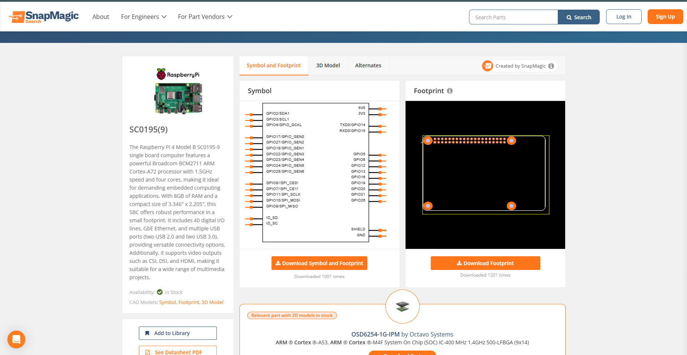
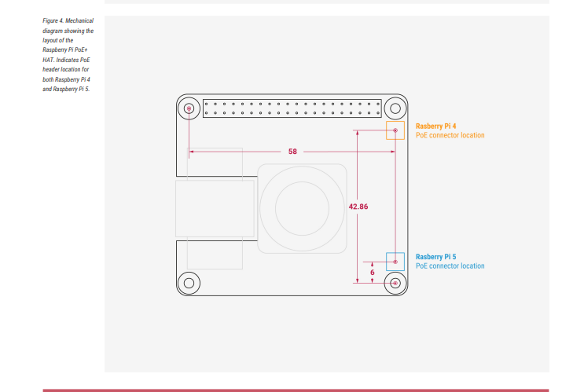
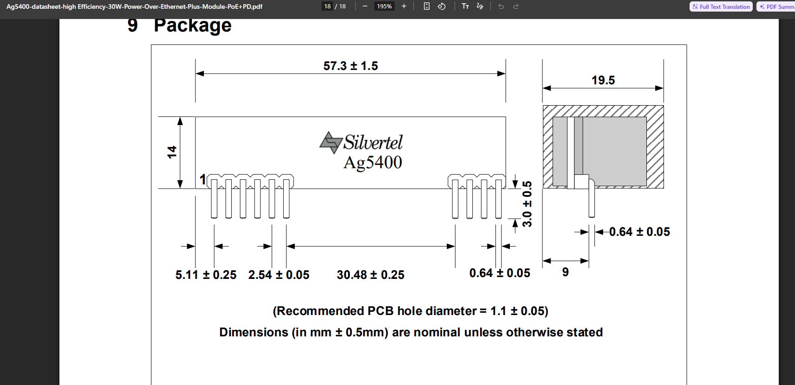
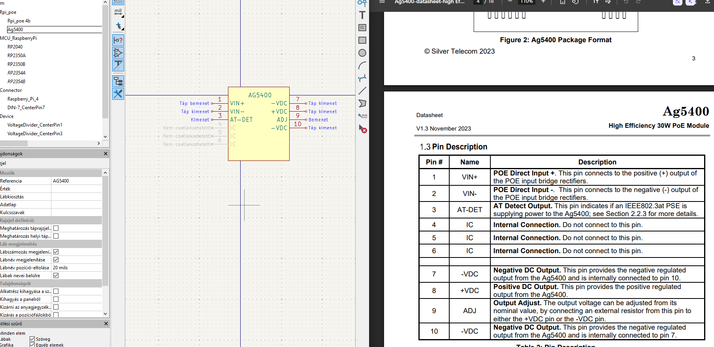
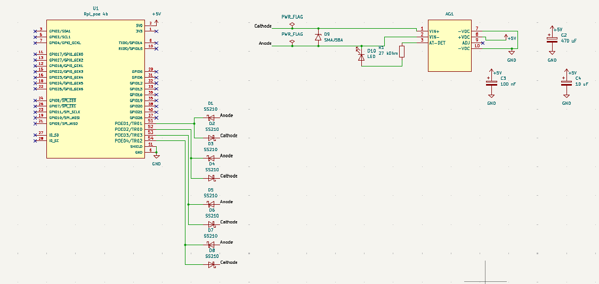
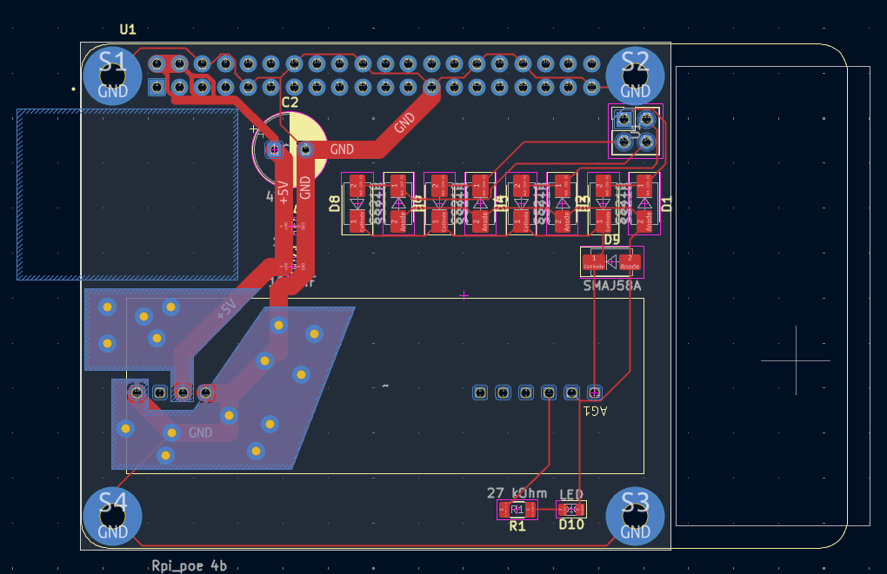
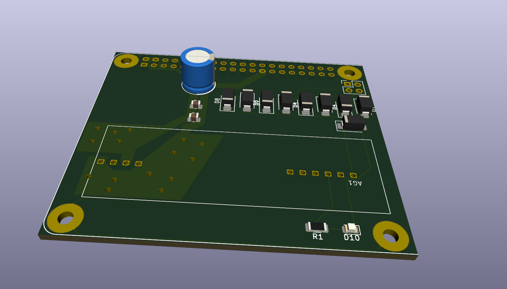

# PiPoE
Hello all! Welcome to my project, PiPoE.
## What it is
PiPoE is a custom made hat by me, that adds PoE functionality to the Rpi 4B SBC.
## How it works
This project uses a PoE manager board from the AG4500 family to supply power to the pi 4.
## How I made it

I had a little problem: There were no schematics or footprints for the pi 4 that contained the PoE pins. So I made them from the official measurements:

And also the module had no files as well, so I made them too using theese references:

# Final designs:
Schematic: 
PCB: 
3D: 
